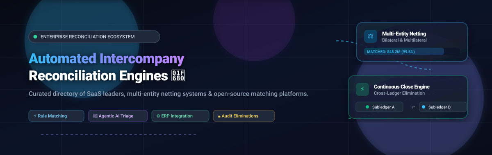

# ⚡ Awesome Automated Intercompany Reconciliation Engines 🚀

<p align="center">
  
</p>

<p align="center">
  <a href="https://github.com/ishandutta2007/Awesome-Awesome-Awesome"></a>
  <a href="https://discord.gg/jc4xtF58Ve"></a>
  <a href="https://github.com/ishandutta2007/Awesome-Automated-Intercompany-Reconciliation-Engines/stargazers"></a>
  <a href="https://github.com/ishandutta2007/Awesome-Automated-Intercompany-Reconciliation-Engines/network/members"></a>
  <a href="https://github.com/ishandutta2007/Awesome-Automated-Intercompany-Reconciliation-Engines/pulls"></a>
  <a href="https://github.com/ishandutta2007/Awesome-Automated-Intercompany-Reconciliation-Engines/blob/main/LICENSE"></a>
  <a href="https://github.com/ishandutta2007"></a>
</p>

---

## 📌 Executive Summary & Repository Overview

> **A curated, production-grade index of Enterprise SaaS platforms, autonomous matching engines, multi-entity netting systems, and open-source financial reconciliation software.**

Corporate accounting and treasury teams at multinational organizations face severe challenges matching cross-subsidiary transactions, resolving intercompany balances, enforcing transfer pricing guidelines, and preparing consolidated financial statements. 

This repository tracks the leading **Automated Intercompany Reconciliation Engines** designed to automate cross-entity ledger matching, streamline period-end close, eliminate manual journal adjustments, and satisfy strict GAAP / IFRS / BEPS 2.0 audit standards.

### 🔍 Quick Jump Table of Contents
- [📊 Sector Overview & Market Dynamics](#-sector-overview--market-dynamics)
- [🏢 SaaS & Enterprise Hosted Platforms](#-saas--enterprise-hosted-platforms)
  - [Enterprise SaaS Comparison Matrix](#-enterprise-saas-comparison-matrix)
  - [Detailed SaaS Engine Profiles](#-detailed-saas-engine-profiles)
- [💻 Open-Source GitHub Projects](#-open-source-github-projects)
- [🧩 Architecture of Modern Intercompany Engines](#-architecture-of-modern-intercompany-engines)
- [🤝 How to Contribute](#-how-to-contribute)
- [💖 Support & Sponsoring](#-support--sponsoring)
- [📈 Star History](#-star-history)
- [⚖️ Disclaimer & Compliance Guidelines](#-disclaimer--compliance-guidelines)

---

## 📊 Sector Overview & Market Dynamics

The global financial close, account reconciliation, and intercompany accounting software market is valued at approximately **$3.5 Billion (2024–2025)** and is projected to expand to **$8.2 Billion by 2030** at an estimated compound annual growth rate (CAGR) of **13.8%**, fueled by complex multi-subsidiary enterprise structures, cross-border tax compliance (OECD BEPS 2.0), and real-time ERP transaction volumes.

The intercompany reconciliation sub-sector exhibits a **moderately fragmented yet increasingly concentrated structure**: the upper enterprise and Fortune 500 tiers are dominated by a handful of established platforms (BlackLine, OneStream, Trintech) operating with high switching costs and deep ERP hooks, while the mid-market and fintech verticals remain dynamically fragmented with emerging AI-native matching engines, open-source frameworks, and modern cloud-first vendors challenging traditional batch-close architectures.

---

## 🏢 SaaS & Enterprise Hosted Platforms

### 📋 Enterprise SaaS Comparison Matrix

The table below compiles leading commercial platforms sorted descending by company size (Valuation / Market Capitalization).

| # | Product | Company Size (Valuation / Revenue) 🏢 | Starting Pricing 💵 | Free Tier / Trial Limits ⏱️ | Core Intercompany Focus 🎯 |
|---|---------|---------------------------------------|----------------------|-----------------------------|---------------------------|
| 1 | **[OneStream](#onestream)** | **~$6.5B Market Cap** (NASDAQ: OS)<br>~$475M ARR | Starts at **$50,000 – $100,000/yr** (~$4,167/mo; Named Interactive Seats ~$99/user/mo; median contract ~$178K/yr) | **0 days free trial** (No self-serve plan; evaluation exclusively via customized partner-scoped enterprise Proof of Concept sandbox) | TXM high-volume matching, SensibleAI risk anomaly detection & continuous elimination |
| 2 | **[BlackLine](#blackline)** | **~$3.2B Market Cap** (NASDAQ: BLST)<br>~$620M ARR | Starts at **$1,083/mo** ($13,000/yr single-module entry; median contracts ~$40,000 – $77,000/yr; intercompany suites typically $100,000+/yr) | **0 days free trial** (No public free tier; guided interactive sandbox demonstration and technical scoping POC upon enterprise qualification) | Dedicated Intercompany Hub: Intercompany Create, Balance & Resolve, bilateral netting |
| 3 | **[HighRadius](#highradius)** | **$3.1B Valuation** (Series C Unicorn)<br>~$180M ARR | **Outcome-Based Pricing** ($0 upfront & $0 until go-live; gain-share model) or module subscriptions starting at **$2,083/mo** ($25,000/yr) | **0 days free trial** (No public free plan; custom value-proof pilot conducted on historical ERP financial records) | Autonomous agentic AI pattern discovery, 95% journal posting automation & variance routing |
| 4 | **[FloQast](#floqast)** | **$1.6B Valuation** (Series E Unicorn)<br>~$100M ARR | Starts at **$999/mo** ($10,000 – $12,000/yr baseline; median contract ~$24,000/yr; mid-market packages range $30,000 – $120,000/yr) | **14-day guided sandbox trial** upon sales qualification (No perpetual free plan; includes test ERP connection & account reconciliation workspace) | AI-powered matching, multi-currency conversion (local/functional), and rapid weeks-long setup |
| 5 | **[Trintech Cadency](#trintech-cadency)** | **~$1.2B Valuation** (Trintech Group)<br>~$160M ARR | Starts at **$25,000/mo** ($300,000/yr enterprise base platform; Fortune 500 deployments range $500,000 – $1,000,000+/yr) | **0 days free trial** (No public self-serve tier; tailored enterprise POC using real customer multi-entity subledger datasets) | Cadency Match transaction-level multi-way reconciliation, preventative controls & daily netting |
| 6 | **[Adra by Trintech](#adra-by-trintech)** | **~$1.2B Valuation** (Trintech Group)<br>~$160M ARR | Starts at **$55 – $95/user/month** (annual deployment minimum baseline starting at ~$30,000 – $40,000/yr including Adra Matcher volume licensing) | **14-day guided proof-of-concept trial** available upon request (No free forever tier; tests transaction matching with sample customer CSV/ERP files) | Mid-market automated transaction matching (Adra Matcher), balance sheet certification & close checklists |
| 7 | **[SmartStream Air](#smartstream-air)** | **~$500M+ Valuation** (Francisco Partners)<br>~$110M ARR | Starts at **~$3,500/mo** (~$42,000/yr entry tier on TLM OnDemand; scales by daily transaction ingestion tier) | **14 to 30-day "Try before you buy" trial** available on request (No free forever tier; capped at processing up to 50,000 test transaction records) | Cloud-native AI Smart Agents for break triage, machine-learning matching & 29x faster break resolution |
| 8 | **[Duco](#duco)** | **~$350M Valuation** (Nordic Capital)<br>~$45M ARR | Starts at **~$4,333/mo** ($52,000/yr entry tier; AWS Marketplace Sandbox Pack listed at $80,000/yr; median contract ~$183,000/yr) | **30-day enterprise evaluation POC** via sales or paid 12-month AWS Sandbox Pack (No free forever plan; covers capped daily ingestion and test users) | Duco Cash intercompany matching, Text Equivalence rules, tolerance write-offs & netted transactions |
| 9 | **[AutoRek](#autorek)** | **~$90M Valuation** (SEP-backed)<br>~£12M ($15M) ARR | Starts at **~$2,500/mo** (~$30,000/yr for core reconciliation module; enterprise multi-entity setups range $60,000 – $150,000/yr) | **30-day proof-of-concept sandbox** provided after solution design scoping (No self-serve free plan; includes configuration for up to 2 data sources) | 99%+ automated rule-based matching, multi-entity sign-off tracking & immutable audit trails |
| 10 | **[ReconArt](#reconart)** | **~$40M Valuation** (Privately held)<br>~$10M ARR | Starts at **$150 – $300/user/month** (Essentials edition baseline starting at ~$1,500/mo or $18,000/yr for up to 25 million transactions/yr) | **0 days free trial** (No public free tier; tailored live walkthrough and customer sample data verification test available via sales) | ReconArt Data Factory (RDF) multi-format normalization (SWIFT, camt.053, BAI) & 98% auto-match rate |

---

### 🔍 Detailed SaaS Engine Profiles

#### OneStream
- **Website**: [onestream.com](https://www.onestream.com/) 🌐
- **Company Scale**: ~$6.5B Market Cap (NASDAQ: OS) | ~$475M ARR
- **Starting Price**: Starts at ~$50,000 – $100,000/yr (Interactive Named Seats ~$99/user/month; median contract ~$178K/yr)
- **Free Tier / Trial Limits**: 0 days free trial (enterprise partner-scoped POC sandbox on sample charts of accounts)
- **Architecture & Capabilities**: Unified platform for financial close, consolidation, and planning. **Transaction Matching (TXM)** automates high-volume cross-entity reconciliations for intercompany, invoice-to-receipt, and credit card balances. **SensibleAI Account Reconciliations** detects anomalies and flags risks (unusual adjustments, missing documentation) early in the close cycle, yielding average **54% time savings**.

#### BlackLine
- **Website**: [blackline.com](https://www.blackline.com/products/intercompany/) 🌐
- **Company Scale**: ~$3.2B Market Cap (NASDAQ: BLST) | ~$620M ARR
- **Starting Price**: Starts at $1,083/mo ($13,000/yr for single module; median contracts ~$40,000 – $77,000/yr; intercompany suites range $100,000+/yr)
- **Free Tier / Trial Limits**: 0 days free trial (guided interactive sandbox walkthrough upon qualification)
- **Architecture & Capabilities**: Intercompany financial management suite with **Intercompany Create**, **Balance & Resolve**, and **Net & Settle** modules. Centralizes multi-ERP data into a global subledger, enforces transfer pricing policies, and executes bilateral netting to slash settlement transactions and foreign exchange bank fees. AI predictive guidance books transactions cleanly before general ledger posting.

#### HighRadius
- **Website**: [highradius.com](https://www.highradius.com/product/reconciliation-software/) 🌐
- **Company Scale**: $3.1B Valuation (Series C Unicorn) | ~$180M ARR
- **Starting Price**: Outcome-Based Pricing ($0 upfront implementation & $0 subscription until go-live) or starting at $2,083/mo ($25,000/yr)
- **Free Tier / Trial Limits**: 0 days free trial (custom outcome pilot with real ERP transaction records)
- **Architecture & Capabilities**: AI-powered reconciliation platform achieving **90%+ automated matching rate**. Autonomous agentic AI discovers matching clusters and patterns, eliminating manual rule maintenance. Provides **95% journal posting automation** to close the loop between reconciliation and ERP general ledgers across 50+ ERP systems.

#### FloQast
- **Website**: [floqast.com](https://www.floqast.com/) 🌐
- **Company Scale**: $1.6B Valuation (Series E Unicorn) | ~$100M ARR
- **Starting Price**: Starts at $999/mo ($10,000 – $12,000/yr baseline; median contract ~$24,000/yr)
- **Free Tier / Trial Limits**: 14-day guided proof-of-concept sandbox trial upon sales qualification
- **Architecture & Capabilities**: Accounting-centered platform delivering rapid deployment (days to weeks). Features **AI-powered matching** that learns from manual team matches, multi-currency conversion across local, functional, and reporting currencies, and direct drill-through visibility from high-level balances down to supporting transactions.

#### Trintech Cadency
- **Website**: [trintech.com/cadency](https://www.trintech.com/cadency/intercompany-accounting/) 🌐
- **Company Scale**: ~$1.2B Valuation (Trintech Group) | ~$160M ARR
- **Starting Price**: Starts at $25,000/mo ($300,000/yr enterprise base; Fortune 500 scopes range $500K – $1M+/yr)
- **Free Tier / Trial Limits**: 0 days free trial (tailored RFP POC using customer multi-entity subledger datasets)
- **Architecture & Capabilities**: Enterprise close automation with **Cadency Match** for transaction-level reconciliation. Reaches **90%+ auto-reconciliation** and **60%+ reduction in settlement time**. Features preventative and detective controls, multi-way matching, complex variance routing, and daily reconciliation capabilities across multi-national entities.

#### Adra by Trintech
- **Website**: [trintech.com/adra](https://www.trintech.com/adra/) 🌐
- **Company Scale**: ~$1.2B Valuation (Trintech Group) | ~$160M ARR
- **Starting Price**: Starts at $55 – $95/user/month (annual platform baseline starting at ~$30,000 – $40,000/yr including Matcher volume)
- **Free Tier / Trial Limits**: 14-day guided trial available upon request with sample CSV/ERP files
- **Architecture & Capabilities**: Financial close automation targeted at mid-market accounting teams. Features **Adra Matcher** for automated multi-way matching, **Adra Balancer** for account reconciliations, and **Adra Task Manager** for tracking close checklists, reducing time spent matching transactions by up to 70%.

#### SmartStream Air
- **Website**: [smartstream-stp.com](https://smart.stream/) 🌐
- **Company Scale**: ~$500M+ Valuation (Francisco Partners) | ~$110M ARR
- **Starting Price**: Starts at ~$3,500/mo (~$42,000/yr baseline tier on TLM OnDemand)
- **Free Tier / Trial Limits**: 14 to 30-day "Try before you buy" trial (capped at processing up to 50,000 test transactions)
- **Architecture & Capabilities**: Cloud-native reconciliation processing 10+ billion monthly transactions. **Smart Agents** (agentic AI layer) triage breaks, retrieve cross-system data, and resolve exceptions end-to-end with human-in-the-loop audit approvals, achieving **29x faster break resolution**.

#### Duco
- **Website**: [duco.com](https://www.duco.com/) 🌐
- **Company Scale**: ~$350M Valuation (Nordic Capital) | ~$45M ARR
- **Starting Price**: Starts at ~$4,333/mo ($52,000/yr entry tier; AWS Sandbox Pack at $80,000/yr; median contract ~$183,000/yr)
- **Free Tier / Trial Limits**: 30-day enterprise evaluation POC or paid 12-month AWS Sandbox Pack (no free forever plan)
- **Architecture & Capabilities**: Cloud-native reconciliation with **Duco Cash** for intercompany matching. Employs **Text Equivalence rules** and reference tables to handle string mismatches, automatic tolerance write-offs, and netted transaction generation with breaking fields root-cause diagnostics.

#### AutoRek
- **Website**: [autorek.com](https://autorek.com/finance-reconciliations/) 🌐
- **Company Scale**: ~$90M Valuation (SEP-backed) | ~£12M ($15M) ARR
- **Starting Price**: Starts at ~$2,500/mo (~$30,000/yr for core module; enterprise multi-entity scopes range $60K – $150K/yr)
- **Free Tier / Trial Limits**: 30-day proof-of-concept sandbox trial provided after solution design scoping
- **Architecture & Capabilities**: Finance reconciliation engine automating balance sheet, bank, and intercompany reconciliations across global entities and currencies. Features 99%+ automated match rates, no-code rule configuration, real-time exception handling, and immutable time-stamped audit trails.

#### ReconArt
- **Website**: [reconart.com](https://www.reconart.com/) 🌐
- **Company Scale**: ~$40M Valuation (Privately held) | ~$10M ARR
- **Starting Price**: Starts at $150 – $300/user/month (Essentials edition starting at ~$1,500/mo or $18,000/yr)
- **Free Tier / Trial Limits**: 0 days free trial (custom demonstration and data verification test via sales)
- **Architecture & Capabilities**: Close automation handling bank statements, intercompany transactions, and GL-to-subledger reconciliations. **ReconArt Data Factory (RDF)** normalizes formats (CSV, XLSX, XML, BAI, ACH, SWIFT MT, camt.053) before matching, reaching **97–98% auto-match rates** within initial cycles.

---

## 💻 Open-Source GitHub Projects

Explore production-grade open-source reconciliation engines, ERP frameworks, programmable financial ledgers, and automated payment settlement systems. 

Projects below are strictly **sorted descending by GitHub star count**, with verified star badges linking directly to each project's stargazers community:

---

### 1. [Odoo](https://github.com/odoo/odoo) [](https://github.com/odoo/odoo/stargazers)
- **Repository**: [`odoo/odoo`](https://github.com/odoo/odoo) 📦
- **License**: LGPL-3.0 ⚖️
- **Tech Stack**: Python, JavaScript, PostgreSQL
- **Intercompany & Reconciliation Capabilities**: Complete open-source business suite with native multi-company accounting, intercompany transaction rules, automatic reciprocal journal entry generation, and bank/subledger statement reconciliation. Enables multi-entity enterprises to synchronize intercompany sales, purchase orders, and mirror balance sheet eliminations.

---

### 2. [Hyperswitch](https://github.com/juspay/hyperswitch) [](https://github.com/juspay/hyperswitch/stargazers)
- **Repository**: [`juspay/hyperswitch`](https://github.com/juspay/hyperswitch) 📦
- **License**: Apache-2.0 ⚖️
- **Tech Stack**: Rust, PostgreSQL, Redis
- **Intercompany & Reconciliation Capabilities**: High-performance payment orchestration platform with an integrated financial reconciliation and settlement engine. Ingests payment gateway reports, processor settlement files, and bank records to automatically detect fee discrepancies, multi-currency FX mismatches, and unsettled intercompany flow breakdowns with millisecond performance.

---

### 3. [ERPNext](https://github.com/frappe/erpnext) [](https://github.com/frappe/erpnext/stargazers)
- **Repository**: [`frappe/erpnext`](https://github.com/frappe/erpnext) 📦
- **License**: GPL-3.0 ⚖️
- **Tech Stack**: Python, Frappe Framework, MariaDB / PostgreSQL, Redis
- **Intercompany & Reconciliation Capabilities**: Full-featured open-source ERP with native multi-entity hierarchy management, intercompany Journal Entries, automated intercompany invoices, and parent-subsidiary consolidation. Serves as the primary operational foundation for specialized reconciliation add-ons like Matcha.

---

### 4. [Midday](https://github.com/midday-ai/midday) [](https://github.com/midday-ai/midday/stargazers)
- **Repository**: [`midday-ai/midday`](https://github.com/midday-ai/midday) 📦
- **License**: AGPL-3.0 ⚖️
- **Tech Stack**: TypeScript, Next.js, Supabase, TailwindCSS
- **Intercompany & Reconciliation Capabilities**: Modern financial management stack featuring automated file reconciliation, document parsing, invoice matching, and live multi-bank transaction syncing. Uses intelligent classification algorithms to match financial transactions against corresponding receipts and invoices.

---

### 5. [Invoice Ninja](https://github.com/invoiceninja/invoiceninja) [](https://github.com/invoiceninja/invoiceninja/stargazers)
- **Repository**: [`invoiceninja/invoiceninja`](https://github.com/invoiceninja/invoiceninja) 📦
- **License**: Source Available / Elastic License 2.0 ⚖️
- **Tech Stack**: PHP, Laravel, Flutter, MySQL
- **Intercompany & Reconciliation Capabilities**: Enterprise invoicing, payment handling, and account reconciliation system supporting multi-company architectures. Reconciles payment transactions against open invoices, tracks partial payments, handles multi-currency transactions, and generates comprehensive ledger audit logs.

---

### 6. [Kill Bill](https://github.com/killbill/killbill) [](https://github.com/killbill/killbill/stargazers)
- **Repository**: [`killbill/killbill`](https://github.com/killbill/killbill) 📦
- **License**: Apache-2.0 ⚖️
- **Tech Stack**: Java, OSGi, PostgreSQL / MySQL
- **Intercompany & Reconciliation Capabilities**: Open-source subscription billing and payments platform with modular payment reconciliation plugins. Automatically matches payment notifications, chargebacks, and refund records with internal invoice accounts and merchant account settlement files.

---

### 7. [Apache Fineract](https://github.com/apache/fineract) [](https://github.com/apache/fineract/stargazers)
- **Repository**: [`apache/fineract`](https://github.com/apache/fineract) 📦
- **License**: Apache-2.0 ⚖️
- **Tech Stack**: Java, Spring Boot, MySQL / PostgreSQL
- **Intercompany & Reconciliation Capabilities**: Core banking technology platform engineered for reliable double-entry general ledger management. Features inter-branch financial transactions, clearing and settlement workflows, and comprehensive reconciliation sub-routines between customer loan/savings accounts and treasury ledgers.

---

### 8. [OpenBoxes](https://github.com/openboxes/openboxes) [](https://github.com/openboxes/openboxes/stargazers)
- **Repository**: [`openboxes/openboxes`](https://github.com/openboxes/openboxes) 📦
- **License**: EPL-1.0 ⚖️
- **Tech Stack**: Groovy, Grails, Java, MySQL
- **Intercompany & Reconciliation Capabilities**: Open-source supply chain and inventory management system designed for multi-location operations. Reconciles inventory transfers, inter-facility purchase shipments, and physical stock mismatches across distributed company entities and internal depots.

---

### 9. [Moov ACH](https://github.com/moov-io/ach) [](https://github.com/moov-io/ach/stargazers)
- **Repository**: [`moov-io/ach`](https://github.com/moov-io/ach) 📦
- **License**: Apache-2.0 ⚖️
- **Tech Stack**: Go (Golang), Docker
- **Intercompany & Reconciliation Capabilities**: Cloud-native library and microservice for reading, writing, and validating Automated Clearing House (ACH) files according to NACHA guidelines. Vital building block for corporate treasury automation, intercompany cash transfers, return code reconciliation, and bank settlement verification.

---

### 10. [Formance Stack](https://github.com/formancehq/stack) [](https://github.com/formancehq/stack/stargazers)
- **Repository**: [`formancehq/stack`](https://github.com/formancehq/stack) 📦
- **License**: Apache-2.0 ⚖️
- **Tech Stack**: Go (Golang), Numscript, PostgreSQL
- **Intercompany & Reconciliation Capabilities**: Programmable financial ledger architecture ("financial core for fintechs"). Features a dedicated **Reconciliation Engine** that continuously compares payment provider transactions (Stripe, Wise, Modulr) with internal double-entry ledger accounts to guarantee ledger balancing and identify payment breaks.

---

### 11. [Matcha](https://github.com/Negentropy-Solutions/matcha) [](https://github.com/Negentropy-Solutions/matcha/stargazers)
- **Repository**: [`Negentropy-Solutions/matcha`](https://github.com/Negentropy-Solutions/matcha) 📦
- **License**: AGPL-3.0 ⚖️
- **Tech Stack**: Python, JavaScript, ERPNext / Frappe (>=15.0.0)
- **Intercompany & Reconciliation Capabilities**: Purpose-built payment and cross-company (XCO) reconciliation app for ERPNext. Reconciles **Payment Entries** against **open invoices** with cross-company scoping, allocation trays (one-to-many, split allocations), **FX gain/loss preview** before posting, and automatic intercompany Journal Entries via bridge accounts. Includes full undo history and an audit-trail logging mechanism.

---

### 12. [YARS (Yet Another Reconciliation System)](https://pkg.go.dev/github.com/aferryc/yars) [](https://github.com/aferryc/yars/stargazers)
- **Repository**: [`aferryc/yars`](https://github.com/aferryc/yars) 📦
- **License**: MIT ⚖️
- **Tech Stack**: Go (Golang), Apache Kafka, PostgreSQL, Google Cloud Storage, Docker
- **Intercompany & Reconciliation Capabilities**: Microservice-based financial reconciliation architecture comparing internal transaction ledgers with external bank statements. Employs an event-driven ingestion pipeline (Kafka), reconciliation worker service, web interface for CSV uploads, and database schemas storing matched and unmatched break summaries.

---

## 🧩 Architecture of Modern Intercompany Engines

Building or evaluating an automated intercompany reconciliation solution requires understanding the end-to-end data pipeline:

```
[ ERP 1: SAP ] ────┐                                           ┌───► [ Auto-Netting Engine ]
                   ├──► [ Normalization / Ingestion Layer ] ───┤
[ ERP 2: Oracle ] ─┤     - Format Normalization (CSV, SWIFT)   ├───► [ Deterministic Rule Matcher ]
                   ├──►  - Currency & FX Re-evaluation         │
[ ERP 3: NetSuite ]┘     - Legal Entity Mapping                └───► [ Agentic AI Break Resolver ]
                                                                               │
                                                                               ▼
                                                                [ Multi-Entity Journal Postings ]
                                                                [ Audit Elimination Records ]
```

### 🔑 Critical Functional Requirements
1. **Multi-Currency & FX Triangulation**: Normalizing functional, transaction, and reporting currencies with historical vs. closing exchange rates to calculate intercompany FX gain/loss.
2. **Deterministic & Fuzzy Matching**: High-throughput rule matching on invoice reference numbers, PO numbers, dates within tolerance bands, and amount variances.
3. **Bilateral & Multilateral Netting**: Consolidating circular payables and receivables across multiple legal subsidiaries to execute a single net settlement transfer.
4. **Automated Elimination**: Preparing balancing debit/credit eliminations for consolidated financial reporting under GAAP and IFRS.
5. **Immutable Audit Trails**: Preserving full lineage of matches, manual approvals, and system-generated journal entries for SOX and external audit reviews.

---

## 🤝 How to Contribute

We welcome additions, corrections, and updates from financial engineers, corporate controllers, and open-source contributors! 🛠️

1. **Fork** the repository 🍴
2. **Add or update entries** in [`README.md`](README.md):
   - For SaaS products: include verified starting price, free tier/trial limits, company valuation/revenue, and intercompany features.
   - For Open-Source projects: provide GitHub link, star badge, license, tech stack, and reconciliation details.
3. Keep descriptions objective, factual, and backed by verifiable documentation.
4. Submit a **Pull Request** with a concise description of your changes.

---

## 💖 Support & Sponsoring

A massive thank you to all contributors, financial controllers, and software engineers working toward automated, transparent corporate accounting! 🌟

If you find this repository valuable:
- ⭐ **Star this repository** to improve discoverability
- 🍴 **Fork it** to maintain your personal reference or contribute new platforms
- 📢 **Share it** with your finance, ERP, and accounting tech communities
- ☕ **Support the maintainer**: Sponsor the creator and buy a coffee via the [GitHub Sponsor Dashboard](https://github.com/sponsors/ishandutta2007)

<p align="center">
  <a href="https://github.com/sponsors/ishandutta2007">
    
  </a>
</p>

---

## 📈 Star History

[](https://star-history.dera.page/#ishandutta2007/Awesome-Automated-Intercompany-Reconciliation-Engines&type=date&legend=top-left)

---

## ⚖️ Disclaimer & Compliance Guidelines

- This repository is a **community-curated directory** provided for educational and research purposes. It does not constitute formal accounting, tax, financial, or legal advice.
- Commercial trademarks and product names (such as BlackLine, Trintech, FloQast, HighRadius, OneStream, Duco) belong to their respective corporate entities.
- Financial systems managing intercompany transactions must strictly comply with local tax regulations, transfer pricing documentation (OECD Transfer Pricing Guidelines / BEPS Action 13), and statutory financial reporting standards (US GAAP ASC 810, IFRS 10 Consolidated Financial Statements).
- Open-source implementations handling sensitive corporate financial ledgers should always undergo rigorous security audits, network isolation, role-based access control (RBAC), and encryption at rest and in transit.

---

<p align="center">
  <b>Built with ❤️ for Controllers, Treasurers, Systems Architects, and FinTech Developers worldwide.</b>
</p>
